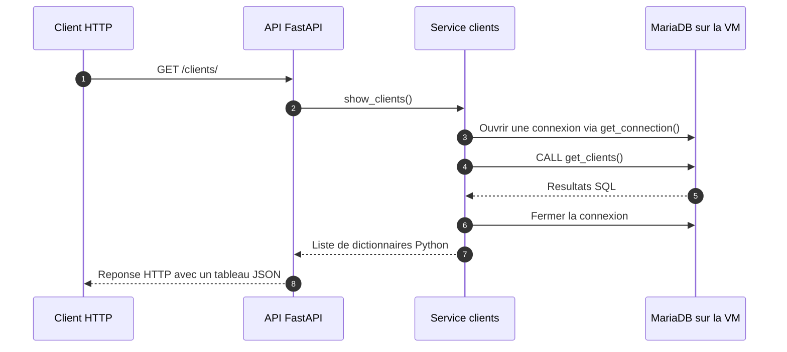

# DEV-APP-METIER

Application de gestion d'un hôtel avec une API Python FastAPI et une base MariaDB hébergée sur une VM. Le client HTTP appelle l'API, qui interroge la base puis renvoie les résultats en JSON.

- [Schéma UML Hôtel-casino en Markdown](docs/uml-hotel-casino.md)

## Initialisation de la base

Pour initialiser MariaDB, exécuter dans cet ordre :

1. [create_bdd.sql](create_bdd.sql) pour créer la base et les tables.
2. [insert_donnees.sql](insert_donnees.sql) pour ajouter les données d'exemple.

Le script d'insertion regroupe les données par table avec `INSERT IGNORE`. Les identifiants fixes permettent de relancer le script : une ligne dont la clé primaire existe déjà est ignorée. Il contient un client, deux chambres, trois rôles, trois membres du personnel, une réservation, un nettoyage et deux créneaux de garde.

Ce jeu de données est destiné à une base de démonstration initialement vide. Une même valeur avec un autre identifiant n'est pas considérée comme un doublon ; les contrôles de chevauchement des réservations et des gardes doivent être assurés par l'application.

## Fonctionnement de l'API

L'API est initialisée dans [main.py](main.py) avec `app = FastAPI()`. Ce fichier enregistre le routeur des clients avec `app.include_router(client_router)`.

Pour une requête `GET /clients/`, le parcours est le suivant :



La route reçoit la requête, le service exécute la requête SQL et FastAPI transforme le résultat Python en JSON. La réponse revient au client qui a appelé la route.

### Répartition du code

| Fichier | Responsabilité |
| --- | --- |
| [main.py](main.py) | Créer l'application FastAPI et enregistrer les routeurs. |
| [routes/client.py](routes/client.py) | Définir la route `GET /clients/` et appeler le service clients. |
| [services/client.py](services/client.py) | Ouvrir une connexion, exécuter `CALL get_clients()`, récupérer les lignes et fermer la connexion. |
| [database.py](database.py) | Configurer la connexion à MariaDB avec PyMySQL. `DictCursor` permet de récupérer les lignes sous forme de dictionnaires. |

### Routes actuellement disponibles

| Méthode | Route | Comportement |
| --- | --- | --- |
| `GET` | `/` | Renvoyer un message d'accueil statique. Cette route n'interroge pas la base et ne vérifie pas la connexion MariaDB. |
| `GET` | `/clients/` | Appeler la procédure SQL `get_clients()` et renvoyer ses résultats en JSON. |

Pour le moment, seul le routeur clients est enregistré dans `main.py`.

Exemple de réponse JSON possible pour `/clients/` :

```json
[
  {
    "id": 1,
    "num_tel": "0600000001",
    "nom": "Dupont",
    "prenom": "Marie"
  }
]
```

### Connexion à MariaDB sur la VM

La configuration actuelle se trouve dans [database.py](database.py) :

| Paramètre | Valeur |
| --- | --- |
| Adresse de la VM | `172.16.113.89` |
| Port MariaDB | `3306` |
| Base utilisée par l'API | `ma_database` |

La machine qui exécute l'API doit pouvoir joindre la VM sur ce port, et le compte configuré doit avoir les droits nécessaires sur la base.

Les scripts SQL du dépôt créent et remplissent `HotelBDD`, alors que l'API utilise actuellement `ma_database`. Pour utiliser ces données avec l'API, aligner le nom de la base dans `database.py` et dans les scripts SQL.

La procédure `get_clients()` doit également exister dans la base utilisée par l'API. Le service l'appelle, mais les scripts SQL du dépôt ne la définissent pas encore.

### Lancer l'API

Depuis la racine du projet, avec les modules `fastapi`, `uvicorn` et `pymysql` installés :

```sh
python -m uvicorn main:app --reload
```

Avec les paramètres par défaut, la route clients est accessible sur <http://127.0.0.1:8000/clients/> et la documentation interactive sur <http://127.0.0.1:8000/docs>.
