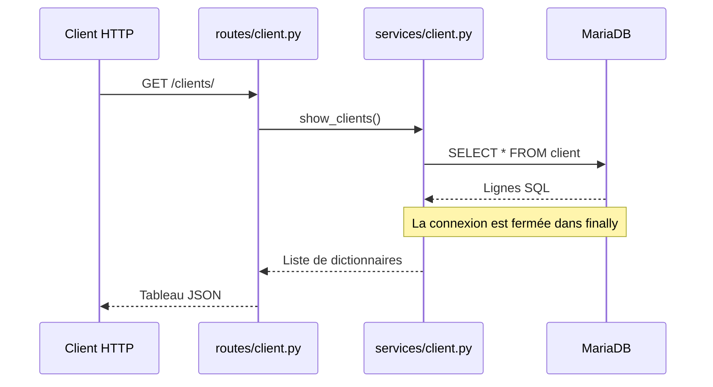

# DEV-APP-METIER

Projet pédagogique de gestion d'un hôtel : API Python avec FastAPI et base de données MariaDB. Le client HTTP appelle une route, le service exécute les requêtes SQL et l'API renvoie une réponse JSON.

## Structure du projet

```text
main.py                Application FastAPI, enregistrement des routeurs et gestion des 404
database.py            Connexion MariaDB avec PyMySQL
routes/                Définition des routes HTTP
services/              Requêtes SQL et gestion des connexions
models/                Modèles Pydantic pour valider les données reçues
create_bdd.sql         Création de la base HotelBDD et des tables
insert_donnees.sql     Données de démonstration
docs/                  Documentation du projet
```

Seul le module clients est implémenté et son routeur enregistré dans `main.py`. Les fichiers des modules chambres, réservations, personnel, rôles, nettoyages et tours de garde sont actuellement vides.

## Installation et lancement

Prérequis : Python avec le module `venv`, MariaDB accessible depuis la machine exécutant l'API et un compte disposant des droits nécessaires.

Ouvrir un terminal dans le dossier contenant `main.py` (le sous-dossier `DEV-APP-METIER` si le terminal se trouve dans le dossier parent).

Sous PowerShell :

```powershell
python -m venv .venv
.\.venv\Scripts\Activate.ps1
python -m pip install fastapi uvicorn pymysql
python -m uvicorn main:app --reload
```

Le dépôt ne contient pas encore de fichier de dépendances avec des versions fixées.

- API : <http://127.0.0.1:8000/>
- Documentation interactive Swagger : <http://127.0.0.1:8000/docs>
- Documentation ReDoc : <http://127.0.0.1:8000/redoc>

## Base de données

La connexion est configurée directement dans [database.py](database.py).

| Paramètre | Valeur actuelle |
| --- | --- |
| Hôte | `172.16.113.89` |
| Port | `3306` |
| Base | `ma_database` |
| Utilisateur | `admin` |

Le mot de passe est également défini dans ce fichier. `pymysql.cursors.DictCursor` renvoie les lignes sous forme de dictionnaires, avec les noms des colonnes comme clés.

Pour initialiser une base de démonstration, exécuter avec un client MariaDB, dans cet ordre :

1. [create_bdd.sql](create_bdd.sql), qui crée `HotelBDD` et ses tables.
2. [insert_donnees.sql](insert_donnees.sql), qui ajoute les données d'exemple.

**Le nom de base doit être aligné avant utilisation** : les scripts ciblent `HotelBDD`, alors que l'API se connecte à `ma_database`.

Les tables prévues sont `client`, `chambre`, `role`, `personnel`, `reservation`, `nettoyage` et `tour_de_garde`.

Les insertions utilisent `INSERT IGNORE` et des identifiants fixes : une ligne dont la clé primaire existe déjà est conservée. Les exemples comprennent un client, deux chambres, trois rôles, trois membres du personnel, une réservation, un nettoyage et deux créneaux de garde. Ces données sont destinées à une base de démonstration initialement vide.

## Fonctionnement de l'API



Les modèles [ClientCreate et ClientUpdate](models/client.py) déclarent trois champs obligatoires de type chaîne : `nom`, `email` et `telephone`. Le modèle de mise à jour exige lui aussi les trois champs.

### Routes déclarées

Ces routes sont présentes dans le code ; les limites ci-dessous expliquent celles qui nécessitent encore une correction.

| Méthode | Route | Comportement prévu |
| --- | --- | --- |
| `GET` | `/` | Message d'accueil statique ; ne vérifie pas la connexion à MariaDB. |
| `GET` | `/clients/` | Liste des clients. |
| `GET` | `/clients/{client_id}` | Client correspondant à l'identifiant. |
| `GET` | `/clients/num/{client_id}` | Numéro de téléphone du client, lu dans `num_tel`. |
| `POST` | `/clients/` | Création d'un client ; statut déclaré `201`. |
| `PUT` | `/clients/{client_id}` | Modification d'un client. |
| `DELETE` | `/clients/{id_client}` | Suppression d'un client ; statut déclaré `204`. |

Exemple de corps JSON attendu par les routes `POST` et `PUT` :

```json
{
  "nom": "Dupont",
  "email": "dupont@example.com",
  "telephone": "0600000001"
}
```

Les services renvoient une erreur HTTP `500` en cas d'échec SQL ou de connexion. Certains cas de client absent déclenchent une erreur `404`. Le gestionnaire global de `main.py` remplace les réponses `404`, y compris celles des services, par un JSON contenant `error`, `message` et `path`, avec le message « La route demandée n'existe pas ».

## Limites actuelles

- **Schéma clients incohérent** : le script SQL définit `id`, `num_tel`, `nom` et `prenom`. Les services de création et de modification utilisent `nom`, `email` et `telephone`. Ils ne sont donc pas compatibles avec la table créée par ce script.
- **Modification** : `update_client()` appelle `updated.commit()` alors que `updated` est un entier provenant de `cursor.rowcount`. Cet appel provoque une erreur ; la transaction devrait être validée sur la connexion.
- **Suppression** : le chemin déclare `id_client`, mais la fonction attend `client_id`. FastAPI traite donc `client_id` comme un paramètre de requête obligatoire au lieu de récupérer l'identifiant du chemin.
- **Authentification et permissions** : aucun contrôle d'accès par rôle n'est encore implémenté.
- **Docker** : le `dockerfile` est vide. Le fichier Compose définit uniquement MariaDB, requiert `DB_PASSWORD` et publie `127.0.0.1:5432:5432`, alors que l'API cible le port MariaDB `3306`. Cette configuration doit être adaptée avant de servir au lancement du projet.

## Documentation complémentaire

- [Schéma UML hôtel-casino](docs/uml-hotel-casino.md)
- [Proposition de contrôle d'accès par rôle](docs/acces-par-role.md)
