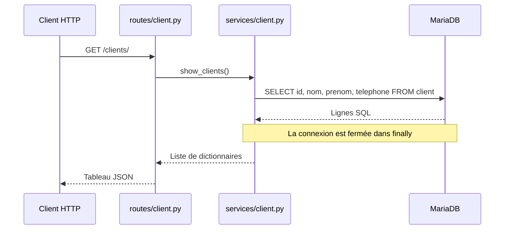

# DEV-APP-METIER

Projet pédagogique de gestion d'un hôtel : API Python avec FastAPI et base de données MariaDB. Le client HTTP appelle une route, le service exécute les requêtes SQL et l'API renvoie une réponse JSON.

## Structure du projet

```text
API/main.py            Application FastAPI et enregistrement des routeurs
API/database.py        Connexion MariaDB avec PyMySQL
API/routes/            Définition des routes HTTP
API/services/          Requêtes SQL et gestion des connexions
API/models/            Modèles Pydantic des données reçues et renvoyées
API/securite.py        Hachage des mots de passe et contrôle des JWT
FRONTEND/              Interface HTML et JavaScript
BDD/                   Scripts de création et données de démonstration
docs/                  Documentation du projet
```

Les routeurs clients, chambres, réservations, personnel, rôles, nettoyages et test JWT sont enregistrés. Les limites des modules métier et les tests réalisés sont décrits dans le [rapport de vérification](docs/verification-2026-11-13.md).

## Installation et lancement

Prérequis : Python avec le module `venv`, MariaDB accessible depuis la machine exécutant l'API et un compte disposant des droits nécessaires.

Ouvrir un terminal à la racine `DEV-APP-METIER`, qui contient les dossiers `API`, `FRONTEND` et le fichier `.env`.

Sous PowerShell :

```powershell
python -m venv .venv
.\.venv\Scripts\Activate.ps1
python -m pip install -r requirements.txt
python -m uvicorn API.main:app --reload --env-file .env
```

Les dépendances sont listées dans `requirements.txt`, sans versions fixées.

- Interface : <http://127.0.0.1:8000/>
- Connexion de l'API à la BDD : <http://127.0.0.1:8000/api>
- Documentation interactive Swagger : <http://127.0.0.1:8000/docs>
- Documentation ReDoc : <http://127.0.0.1:8000/redoc>

## Base de données

La connexion est configurée dans [API/database.py](API/database.py) à partir des variables `DB_HOST`, `DB_PORT`, `DB_NAME`, `DB_USER` et `DB_PASSWORD`, chargées depuis `.env` par la commande de lancement.

| Paramètre | Valeur actuelle |
| --- | --- |
| Hôte | `DB_HOST` dans `.env` |
| Port | `DB_PORT`, par défaut `3306` |
| Base | `DB_NAME` dans `.env` |
| Utilisateur | `DB_USER` dans `.env` |

Le mot de passe est lu depuis `DB_PASSWORD`. `pymysql.cursors.DictCursor` renvoie les lignes sous forme de dictionnaires, avec les noms des colonnes comme clés.

Pour initialiser une base de démonstration, exécuter avec un client MariaDB, dans cet ordre :

1. [BDD/create_bdd.sql](BDD/create_bdd.sql), qui crée `HotelBDD` et ses tables.
2. [BDD/insert_donnees.sql](BDD/insert_donnees.sql), qui ajoute les données d'exemple.

**Les scripts doivent être alignés avant une nouvelle initialisation** : ils ciblent `HotelBDD` et l'ancien champ client `num_tel`, tandis que l'API utilise `DB_NAME` et le champ `telephone`. Ils ne créent pas encore les champs de mots de passe de la base actuelle.

Les tables prévues sont `client`, `chambre`, `role`, `personnel`, `reservation`, `nettoyage` et `tour_de_garde`.

Les insertions utilisent `INSERT IGNORE` et des identifiants fixes : une ligne dont la clé primaire existe déjà est conservée. Les exemples comprennent un client, deux chambres, trois rôles, trois membres du personnel, une réservation, un nettoyage et deux créneaux de garde. Ces données sont destinées à une base de démonstration initialement vide.

## Fonctionnement de l'API



Les modèles [ClientCreate et ClientUpdate](API/models/client.py) déclarent `nom`, `prenom` et `telephone`. La création exige aussi `mot_de_passe`, haché avant l'insertion. `ClientPublic` limite les réponses à `id`, `nom`, `prenom` et `telephone`, sans mot de passe ni hash.

### Routes déclarées

Ces routes sont présentes dans le code ; les limites ci-dessous expliquent celles qui nécessitent encore une correction.

| Méthode | Route | Comportement prévu |
| --- | --- | --- |
| `GET` | `/` | Interface de liste des clients. |
| `GET` | `/api` | Ouvre une connexion à MariaDB pour vérifier sa disponibilité. |
| `GET` | `/clients/` | Liste des clients. |
| `GET` | `/clients/{client_id}` | Client correspondant à l'identifiant. |
| `POST` | `/clients/` | Création d'un client ; statut déclaré `201`. |
| `PUT` | `/clients/{client_id}` | Modification d'un client. |
| `DELETE` | `/clients/{client_id}` | Suppression d'un client ; statut déclaré `204`. |
| `GET` | `/auth/test` | Vérifie le JWT reçu dans le header `Authorization`. |

Exemple de corps JSON attendu par la route `PUT` ; pour `POST`, ajouter le champ `mot_de_passe` :

```json
{
  "nom": "Dupont",
  "prenom": "Marie",
  "telephone": "0600000001"
}
```

Les services renvoient une erreur HTTP `500` en cas d'échec SQL ou de connexion. Certains cas de client absent déclenchent une erreur `404`. Le gestionnaire global de `API/main.py` remplace les réponses `404`, y compris celles des services, par un JSON contenant `error`, `message` et `path`, avec le message « La route demandée n'existe pas ».

## Limites actuelles

- **Modules métier** : plusieurs routes chambres et réservations échouent ; des modifications du personnel, des rôles et des nettoyages restent à corriger. Voir les résultats détaillés dans le [rapport de vérification](docs/verification-2026-11-13.md).
- **Authentification et permissions** : le contrôle JWT de test fonctionne ; la connexion utilisateur et les restrictions par rôle ne sont pas encore implémentées.
- **Initialisation et Docker** : les scripts SQL restent à aligner sur le schéma actuel. Docker n'a pas été exécuté lors de cette vérification.

## Documentation complémentaire

- [Comprendre le fonctionnement de l’API](docs/fonctionnement-api.md)
- [Schéma UML hôtel-casino](docs/uml-hotel-casino.md)
- [Proposition de contrôle d'accès par rôle](docs/acces-par-role.md)
