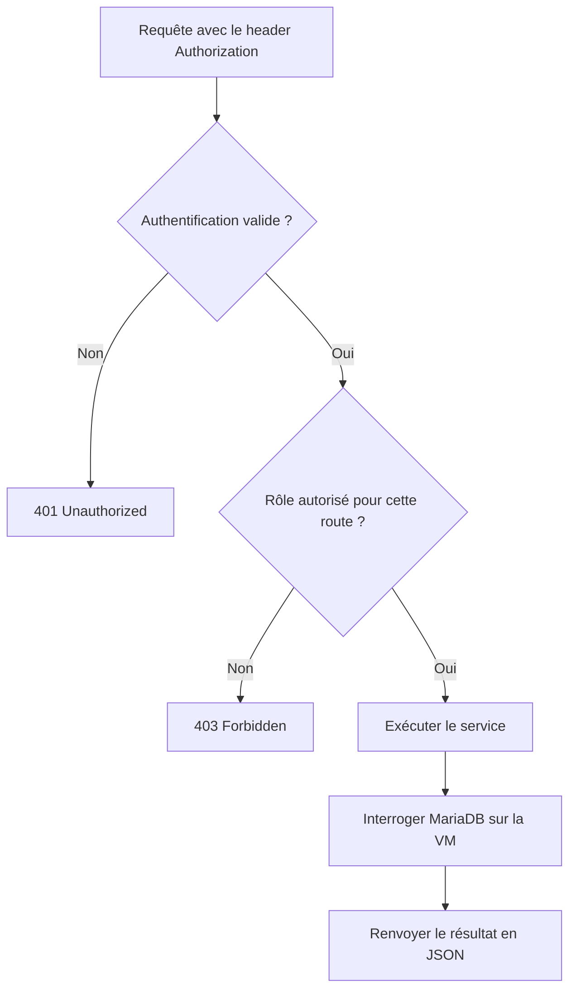

# Contrôle d'accès aux routes par rôle

Ce document explique le fonctionnement proposé pour l'API FastAPI du projet. Il décrit le mécanisme ; il ne signifie pas que l'authentification et les permissions sont déjà implémentées.

## À quoi sert un header ?

Un header HTTP est une information envoyée avec une requête. Le navigateur, le frontend ou un outil comme Postman peut transmettre un jeton d'authentification dans le header `Authorization` :

```http
GET /clients/ HTTP/1.1
Authorization: Bearer <jeton>
```

`Bearer` indique que le client présente un jeton. L'API doit vérifier ce jeton avant de lui faire confiance.

## Identité, rôle et autorisation

- **Authentification** : vérifier qui est l'utilisateur.
- **Rôle** : connaître sa fonction, par exemple réceptionniste, manager ou client.
- **Autorisation** : vérifier si cet utilisateur peut accéder à la route demandée.

Un header comme `Role: manager` ne prouve pas que l'utilisateur est manager : la personne qui envoie la requête peut modifier sa valeur.

Le rôle doit donc provenir d'une information vérifiée par le serveur. Par exemple, l'API peut vérifier un jeton signé, en extraire l'identifiant de l'utilisateur puis retrouver son rôle dans la base. Le rôle peut aussi être contenu dans le jeton signé, selon la conception retenue.

## Parcours d'une requête

1. L'utilisateur se connecte et reçoit un jeton après vérification de son identité.
2. Le client transmet ce jeton dans le header `Authorization` lors de l'appel à une route.
3. L'API vérifie la validité du jeton, notamment sa signature et son expiration si c'est un JWT.
4. Elle identifie l'utilisateur et détermine son rôle.
5. Elle compare ses permissions à celles nécessaires pour accéder à la route.
6. Si l'accès est autorisé, elle exécute le service, interroge MariaDB puis renvoie le JSON.



## Exemple pour GET /clients/

Supposons que la liste complète des clients soit réservée aux réceptionnistes et aux managers. Cette politique est un exemple à adapter aux droits métier du projet.

| Situation | Résultat |
| --- | --- |
| Réceptionniste authentifié | Accès autorisé. |
| Manager authentifié | Accès autorisé. |
| Client authentifié | `403 Forbidden` : son rôle ne permet pas de consulter la liste complète. |
| Jeton absent, invalide ou expiré | `401 Unauthorized` : l'authentification est nécessaire. |

Un accès autorisé permet d'exécuter le service ; il ne garantit pas que la requête SQL réussira. Une indisponibilité de MariaDB reste une erreur distincte.

## Où placer le contrôle dans FastAPI ?

Pour la route clients du projet, le contrôle se placerait avant l'appel à `show_clients()` dans [routes/client.py](../routes/client.py).

Une dépendance FastAPI avec `Depends` peut regrouper la vérification de l'utilisateur et de ses permissions. Les routes protégées utilisent cette dépendance pour éviter de répéter les contrôles.

Si l'accès est refusé, le service métier n'est pas exécuté et la requête de lecture des clients n'est pas envoyée à MariaDB. La vérification de l'identité ou du rôle peut elle-même nécessiter une lecture en base.

## Documentation de référence

- [FastAPI — Authentification avec jetons JWT](https://fastapi.tiangolo.com/tutorial/security/oauth2-jwt/).
- [FastAPI — Autorisations et dépendances de sécurité](https://fastapi.tiangolo.com/advanced/security/oauth2-scopes/).
