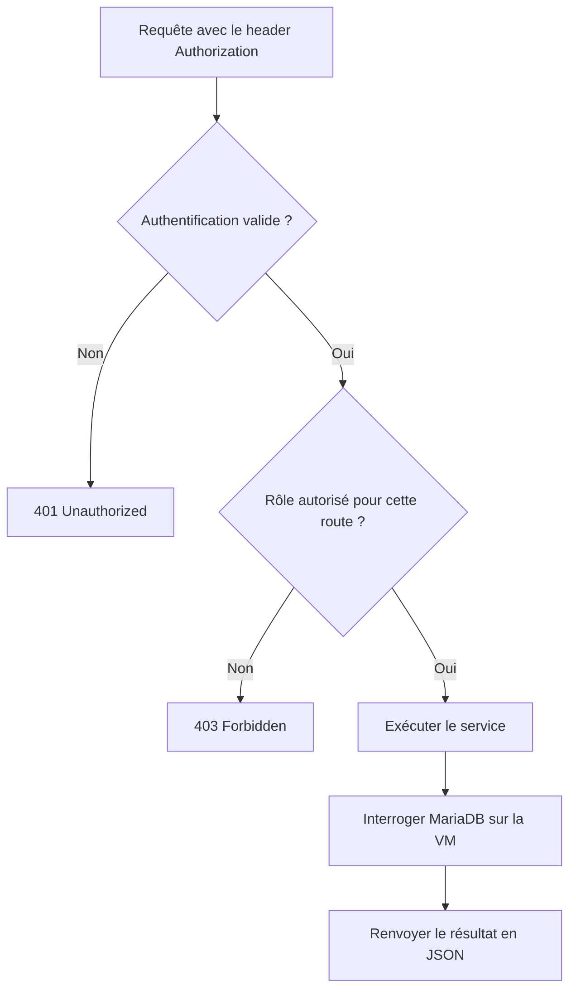
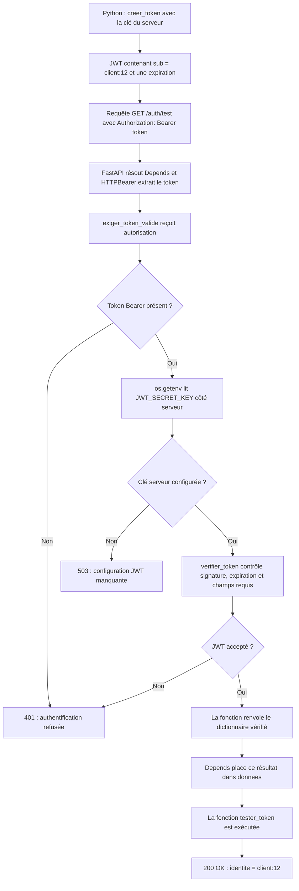
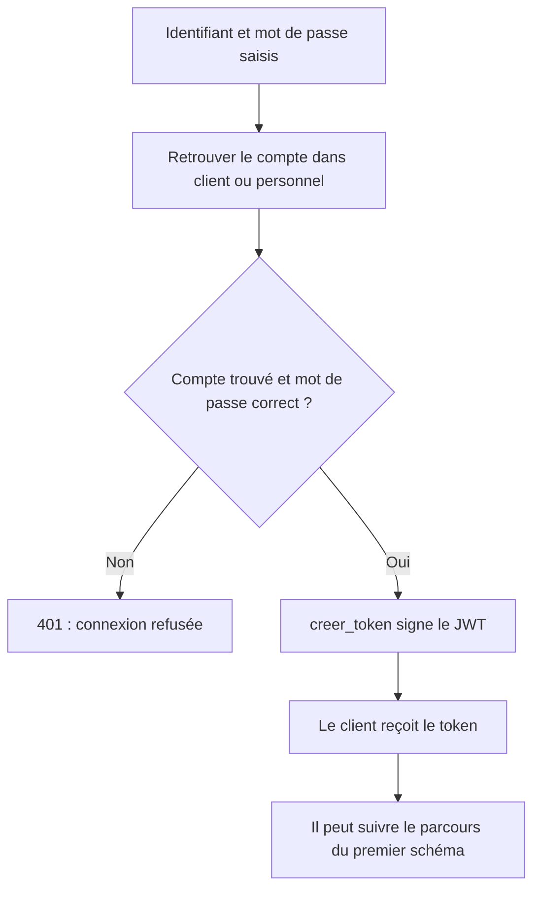

# Contrôle d'accès aux routes par rôle

Ce document explique le contrôle d'accès de l'API FastAPI du projet. Le code contient les fonctions de hachage et de JWT, la dépendance de vérification du token et la route de test `/auth/test`. La connexion aux comptes en BDD et les permissions métier restent à brancher. La présence du code ne remplace pas un test de l'API en fonctionnement.

## À quoi sert un header ?

Un header HTTP est une information envoyée avec une requête. Le navigateur, le frontend ou un outil comme Postman peut transmettre un jeton d'authentification dans le header `Authorization` :

```http
GET /clients/ HTTP/1.1
Authorization: Bearer <jeton>
```

`Bearer` indique que le client présente un jeton. L'API doit vérifier ce jeton avant de lui faire confiance.

## Identité, rôle et autorisation

- **Authentification** : vérifier qui est l'utilisateur.
- **Rôle** : connaître sa fonction, par exemple réceptionniste, manager ou client.
- **Autorisation** : vérifier si cet utilisateur peut accéder à la route demandée.

Un header comme `Role: manager` ne prouve pas que l'utilisateur est manager : la personne qui envoie la requête peut modifier sa valeur.

Le rôle doit donc provenir d'une information vérifiée par le serveur. Par exemple, l'API peut vérifier un jeton signé, en extraire l'identifiant de l'utilisateur puis retrouver son rôle dans la base. Le rôle peut aussi être contenu dans le jeton signé, selon la conception retenue.

## Parcours d'une requête

1. L'utilisateur se connecte et reçoit un jeton après vérification de son identité.
2. Le client transmet ce jeton dans le header `Authorization` lors de l'appel à une route.
3. L'API vérifie la validité du jeton, notamment sa signature et son expiration si c'est un JWT.
4. Elle identifie l'utilisateur et détermine son rôle.
5. Elle compare ses permissions à celles nécessaires pour accéder à la route.
6. Si l'accès est autorisé, elle exécute le service, interroge MariaDB puis renvoie le JSON.



## Schéma détaillé : du token à la route

Ce premier schéma décrit le test `GET /auth/test`, qui fonctionne sans BDD. Le token de test est créé en Python avec **la même clé secrète que celle configurée dans l'API**. `client:12` est une identité fictive utilisée pour expliquer le parcours.

Au démarrage, `--env-file .env` charge la configuration et `app.include_router(auth_router)` enregistre la route. Ces opérations préparent l'API avant les requêtes.



### Comment lire le schéma

- **Le header transporte le token.** Le client joint `Authorization: Bearer token` à sa requête.
- **HTTPBearer extrait sa valeur.** FastAPI résout cette dépendance avant d'appeler `exiger_token_valide`.
- **La clé reste sur le serveur.** Elle sert à signer le token lors de sa création, puis à vérifier sa signature. Elle n'est pas envoyée dans le header.
- **Une erreur arrête la requête.** Si le header est absent ou incorrect, ou si le JWT est invalide ou expiré, la réponse est `401` et la fonction de la route n'est pas exécutée. Une clé serveur absente produit `503`.
- **Depends transmet le résultat.** Après validation, le dictionnaire renvoyé par `exiger_token_valide` devient la valeur de `donnees` dans `tester_token`.
- **La route répond avec l'identité.** Elle lit `donnees["sub"]` et renvoie, pour cet exemple, `{"identite": "client:12"}`.

### Connexion réelle : étape à brancher sur la BDD

Le test précédent crée le token manuellement. Lors de la future connexion, sa création sera conditionnée par la vérification du compte et de son mot de passe :



Pour les routes métier, il faudra ensuite retrouver le compte à partir du JWT vérifié, contrôler qu'il peut encore se connecter et vérifier ses permissions **avant d'exécuter le service métier**. Un compte authentifié sans la permission requise recevra `403`. Un JWT valide ne prouve pas à lui seul que le compte existe encore ni qu'il possède tous les droits.

## Exemple pour GET /clients/

Supposons que la liste complète des clients soit réservée aux réceptionnistes et aux managers. Cette politique est un exemple à adapter aux droits métier du projet.

| Situation | Résultat |
| --- | --- |
| Réceptionniste authentifié | Accès autorisé. |
| Manager authentifié | Accès autorisé. |
| Client authentifié | `403 Forbidden` : son rôle ne permet pas de consulter la liste complète. |
| Jeton absent, invalide ou expiré | `401 Unauthorized` : l'authentification est nécessaire. |

Un accès autorisé permet d'exécuter le service ; il ne garantit pas que la requête SQL réussira. Une indisponibilité de MariaDB reste une erreur distincte.

## Où placer le contrôle dans FastAPI ?

Pour la route clients du projet, le contrôle se placerait avant l'appel à `show_clients()` dans [API/routes/client.py](../API/routes/client.py).

Une dépendance FastAPI avec `Depends` peut regrouper la vérification de l'utilisateur et de ses permissions. Les routes protégées utilisent cette dépendance pour éviter de répéter les contrôles.

Si l'accès est refusé, le service métier n'est pas exécuté et la requête de lecture des clients n'est pas envoyée à MariaDB. La vérification de l'identité ou du rôle peut elle-même nécessiter une lecture en base.

## Documentation de référence

- [FastAPI — Authentification avec jetons JWT](https://fastapi.tiangolo.com/tutorial/security/oauth2-jwt/).
- [FastAPI — Autorisations et dépendances de sécurité](https://fastapi.tiangolo.com/advanced/security/oauth2-scopes/).
