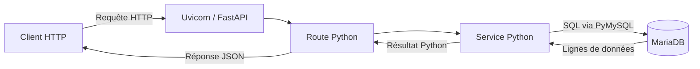

# Comprendre le fonctionnement de l’API

Cette documentation décrit le code présent dans le projet. Les exemples de réponses contenant des données sont illustratifs : le contenu réel dépend de ta base MariaDB. Les fonctionnalités envisagées, comme l’authentification, sont signalées explicitement.

## 1. À quoi sert cette API ?

Le projet sert à gérer des données d’hôtel : clients, chambres, réservations, personnel, rôles, nettoyages et tours de garde.

Une API est un point d’entrée que d’autres programmes peuvent appeler. Par exemple, une interface de réception pourrait demander la liste des clients à l’API. L’API lit alors la base de données et renvoie les informations.

Dans ce projet :

- **Le client HTTP** envoie une demande : navigateur, frontend, Postman ou commande PowerShell. Attention, ce « client HTTP » n’est pas forcément un client de l’hôtel.
- **Uvicorn** est le serveur qui reçoit les requêtes HTTP et fait fonctionner l’application Python.
- **FastAPI** associe la requête à la bonne fonction et vérifie les données attendues.
- **Les services Python** exécutent les opérations SQL.
- **MariaDB** conserve les données entre deux appels et entre deux redémarrages de l’API.



Le client HTTP ne lance pas lui-même la requête SQL. C’est le code du serveur qui décide quelle opération effectuer.

## 2. Les fichiers et leur responsabilité

| Fichier ou dossier | Responsabilité | Exemple |
| --- | --- | --- |
| `main.py` | Créer l’application et brancher les routeurs | `app.include_router(client_router)` |
| `routes/` | Définir les URL, méthodes HTTP et fonctions appelées | `GET /clients/` appelle `get_clients()` |
| `models/` | Décrire et valider les données reçues | `ClientCreate` exige `nom`, `email`, `telephone` |
| `services/` | Effectuer les opérations sur les données | `show_clients()` exécute un `SELECT` |
| `database.py` | Ouvrir une connexion à MariaDB | `get_connection()` |
| `create_bdd.sql` | Définir les tables et leurs relations | Table `reservation` liée à `client` et `chambre` |
| `insert_donnees.sql` | Ajouter les données de démonstration | Lignes initiales dans les tables |
| `requirements.txt` | Lister les dépendances Python | FastAPI, Uvicorn, PyMySQL |

Un **routeur** est un regroupement de routes. Dans `routes/client.py`, le préfixe `/clients` est partagé par toutes les routes du fichier.

Les **modèles Pydantic** de ce projet ne sont pas des tables et ne font pas de SQL. Ils décrivent les données reçues par les routes. La structure réelle des tables est définie dans le script SQL.

## 3. Ce qui est accessible actuellement

Dans `main.py`, seul `client_router` est enregistré. Les fichiers des autres modules existent, mais leurs routes ne sont pas exposées par cette application tant que leurs routeurs ne sont pas importés et enregistrés. Leur présence sur disque ne suffit pas.

| Méthode | Chemin | Fonction appelée | Objectif |
| --- | --- | --- | --- |
| `GET` | `/` | `accueil()` | Renvoyer un message statique |
| `GET` | `/clients/` | `get_clients()` | Lire tous les clients |
| `GET` | `/clients/{client_id}` | `get_client()` | Lire un client |
| `POST` | `/clients/` | `create_client()` | Créer un client |
| `PUT` | `/clients/{client_id}` | `modifier_client()` | Modifier un client |
| `DELETE` | `/clients/{id_client}` | `delete_client()` | Supprimer un client |

Ce tableau décrit les routes déclarées, pas une garantie que chacune fonctionne jusqu’au bout. Les problèmes connus sont détaillés plus bas.

La route `/` renvoie « API connectée à MariaDB », mais **elle n’ouvre aucune connexion à la base**. Sa réussite prouve seulement que l’application répond.

## 4. Comment lire une requête HTTP ?

Prenons cette URL :

```text
http://127.0.0.1:8000/clients/3
```

- `http` est le protocole utilisé.
- `127.0.0.1` désigne ta propre machine.
- `8000` est le port d’écoute de l’API.
- `/clients/3` est le chemin demandé : ici, le client d’identifiant `3`.

La **méthode HTTP** précise l’action :

| Méthode | Intention dans le projet |
| --- | --- |
| `GET` | Lire des données |
| `POST` | Créer une donnée |
| `PUT` | Modifier une donnée |
| `DELETE` | Supprimer une donnée |

Ces quatre opérations sont souvent appelées **CRUD** : Create, Read, Update, Delete.

Une requête peut transmettre des informations à trois endroits :

| Emplacement | Exemple | Utilité |
| --- | --- | --- |
| Chemin | `/clients/3` | Identifier la ressource |
| Paramètres de requête, après `?` | `?client_id=3` | Fournir un paramètre séparé du chemin |
| Corps JSON | `{"nom": "Dupont", ...}` | Fournir les données à créer ou modifier |

Les **headers** donnent des informations supplémentaires, par exemple `Content-Type: application/json` pour annoncer un corps JSON. Le header `Authorization` pourrait plus tard transmettre un jeton d’authentification ; il n’est pas exploité actuellement pour protéger les routes.

## 5. Parcours complet : lire un client

Tu envoies :

```http
GET /clients/3
```

### Étape 1 — FastAPI trouve la route

Dans `routes/client.py` :

```python
@router.get("/{client_id}")
def get_client(client_id: int):
    return show_client(client_id)
```

Le préfixe `/clients` et le chemin `/{client_id}` donnent ensemble `/clients/{client_id}`.

Le décorateur `@router.get(...)` relie une requête `GET` à la fonction située juste dessous. FastAPI récupère `3` dans l’URL et le convertit en entier grâce à `client_id: int`.

Si tu envoies `/clients/bonjour`, la conversion en entier échoue : FastAPI renvoie une erreur `422` avant d’appeler le service.

### Étape 2 — La route appelle le service

`get_client(3)` appelle `show_client(3)` dans `services/client.py`.

La route s’occupe ici de l’entrée HTTP ; le service contient la lecture en base.

### Étape 3 — Le service ouvre une connexion

```python
connection = get_connection()
```

Cette fonction vient de `database.py`. PyMySQL tente de se connecter à MariaDB avec la configuration de l’environnement.

### Étape 4 — Le service exécute le SQL

```python
with connection.cursor() as cursor:
    cursor.execute(
        "SELECT * FROM client WHERE id = %s",
        (client_id,)
    )
    client = cursor.fetchone()
```

Le **curseur** permet d’envoyer une instruction SQL et de récupérer son résultat.

- `SELECT *` demande toutes les colonnes.
- `FROM client` indique la table.
- `WHERE id = %s` sélectionne l’identifiant fourni séparément.
- `(client_id,)` est un tuple Python à un élément. La virgule est nécessaire pour former ce tuple.
- `fetchone()` récupère une ligne, ou `None` si aucune ne correspond.

Le paramètre `%s` est traité par PyMySQL avec la valeur fournie séparément. Il faut garder cette approche plutôt que construire du SQL par concaténation des entrées utilisateur.

### Étape 5 — Le service ferme la connexion

```python
finally:
    connection.close()
```

Une fois la connexion ouverte, le bloc `finally` ferme celle-ci même si une erreur survient pendant la lecture. Le bloc `with` gère la fermeture du curseur.

### Étape 6 — Le résultat revient au client HTTP

La connexion utilise `DictCursor` : une ligne devient un dictionnaire Python dont les clés sont les noms des colonnes.

Si la table correspond à `create_bdd.sql`, le résultat pourrait être :

```json
{
  "id": 3,
  "num_tel": "0600000003",
  "nom": "Dupont",
  "prenom": "Camille"
}
```

Le service renvoie ce dictionnaire, la route le retourne et FastAPI le transforme en réponse JSON. Aucun modèle de réponse explicite ne filtre actuellement les colonnes du résultat clients.

Si le client n’existe pas, le service lève une erreur HTTP `404`. Si la connexion ou le SQL échoue, il renvoie une erreur HTTP `500`.

## 6. Lire une liste ou une seule ligne

`GET /clients/` appelle `show_clients()`, qui exécute :

```sql
SELECT * FROM client
```

Le service utilise `fetchall()` et renvoie une liste de dictionnaires. Sans client, le résultat est une liste vide `[]`, avec un statut `200` si la lecture réussit.

À l’inverse, `GET /clients/3` utilise `fetchone()` et renvoie un objet unique ou une erreur `404`.

## 7. Parcours d’une création

La route `POST /clients/` attend un corps de cette forme :

```json
{
  "nom": "Dupont",
  "email": "camille@example.com",
  "telephone": "0600000003"
}
```

Son paramètre `client: ClientCreate` demande à FastAPI de lire le JSON et de le valider avec ce modèle :

```python
class ClientCreate(BaseModel):
    nom: str
    email: str
    telephone: str
```

Les trois champs sont obligatoires. Un champ manquant ou une valeur incompatible produit une erreur `422`. `email: str` exige une chaîne : cela ne vérifie pas, à lui seul, que l’adresse email est valide. Le téléphone est une chaîne, ce qui permet de conserver son zéro initial.

Si la validation réussit, la route transmet les valeurs à `insert_client()`. Le service tente un `INSERT`, récupère l’identifiant généré avec `cursor.lastrowid`, puis appelle `connection.commit()`.

**`commit()` valide la transaction**, c’est-à-dire les modifications effectuées sur cette connexion. Exécuter une écriture SQL et valider cette écriture sont deux étapes distinctes.

En cas de réussite, la route est configurée pour répondre `201` avec un objet de cette forme :

```json
{
  "message": "Client ajouté",
  "id": 3
}
```

**Limite actuelle :** le script SQL crée `num_tel`, `nom`, `prenom`, alors que cette création utilise `nom`, `email`, `telephone`. Avec la table du script, la requête de création échoue. Le JSON ci-dessus illustre donc le contrat attendu par le code, sans garantir une insertion réussie.

## 8. Modification et suppression

### Modifier avec PUT

`PUT /clients/3` attend les mêmes trois champs que la création. `ClientUpdate` les déclare tous obligatoires : envoyer seulement le téléphone ne suffit pas.

Le service exécute un `UPDATE ... WHERE id = %s`. `cursor.rowcount` indique le nombre de lignes affectées. Une valeur de zéro peut aussi correspondre à des valeurs déjà identiques ; le service prévoit donc une lecture supplémentaire pour vérifier si le client existe.

Cependant, le code appelle actuellement `updated.commit()`, alors que `updated` est un entier. Cet appel échoue ; la validation devrait se faire sur la connexion. Le décalage entre les colonnes SQL et les champs du modèle constitue également un problème.

### Supprimer avec DELETE

Le service de suppression exécute un `DELETE`, valide avec `connection.commit()` et vérifie si une ligne a été supprimée. Une contrainte de clé étrangère peut empêcher la suppression d’un client encore référencé par une réservation.

La route comporte actuellement un décalage de nom :

```python
@router.delete("/{id_client}", status_code=204)
def delete_client(client_id: int):
    return supprimer_client(client_id)
```

`id_client` et `client_id` ne sont pas le même nom. FastAPI attend donc `client_id` en paramètre de requête. Un simple `DELETE /clients/3` produit une erreur `422`. Si le paramètre de requête est fourni, c’est sa valeur qui est transmise au service, ce qui rend le comportement incohérent avec le chemin.

Le statut déclaré `204` correspond à une réponse sans corps : il ne faut pas compter sur le message renvoyé par le service pour cette route.

## 9. Comprendre les réponses et les erreurs

Une réponse HTTP contient notamment un **statut** et éventuellement un **corps JSON**.

| Statut | Sens dans ce projet |
| --- | --- |
| `200` | Lecture ou opération réussie avec le statut par défaut |
| `201` | Création réussie |
| `204` | Suppression réussie, sans corps de réponse |
| `404` | Route inconnue ou ressource absente |
| `422` | Données reçues non conformes aux paramètres ou modèles attendus |
| `500` | Erreur serveur, par exemple connexion ou requête SQL en échec |

Dans les services, `raise HTTPException(...)` interrompt le traitement normal et demande à FastAPI de produire une réponse d’erreur.

Les blocs `try` exécutent une opération susceptible d’échouer ; les blocs `except` traitent l’erreur ; les blocs `finally` exécutent le nettoyage prévu.

### Particularité des erreurs 404

`main.py` possède un gestionnaire global qui remplace les réponses `404`, y compris celles levées pour un client introuvable. Par exemple :

```json
{
  "error": "404 - Not Found",
  "message": "La route demandée n'existe pas",
  "path": "/clients/999"
}
```

Ce message peut donc apparaître même lorsque la route existe mais que le client `999` est absent. Le détail « Client introuvable » du service est remplacé par ce gestionnaire.

Les messages `500` sont aussi assez généraux : « Erreur de connexion à la BDD » peut désigner une erreur SQL, comme une colonne absente, et pas seulement une panne réseau.

## 10. Comment la base est configurée

`database.py` lit les variables d’environnement suivantes :

| Variable | Valeur utilisée si la variable est absente |
| --- | --- |
| `DB_HOST` | `localhost` |
| `DB_PORT` | `3306` |
| `DB_USER` | `root` |
| `DB_PASSWORD` | Chaîne vide |
| `DB_NAME` | `api_test` |

Le script de création utilise le nom **`HotelBDD`**. Si tu initialises cette base, il faut configurer `DB_NAME` en conséquence. Ces valeurs décrivent le code actuel ; certains passages du README décrivent une ancienne configuration.

Les variables doivent être présentes dans l’environnement du processus qui lance Uvicorn. `database.py` ne charge pas lui-même un fichier `.env`.

Les relations SQL définies sont :

- Un membre du personnel référence un rôle avec `id_role`.
- Une réservation référence un client et une chambre.
- Un nettoyage référence un membre du personnel et une chambre.
- Un tour de garde référence un membre du personnel.

Une **clé étrangère** impose qu’un identifiant référencé corresponde à une ligne existante. Elle ne vérifie pas toutes les règles métier : par exemple, le simple lien d’une réservation vers une chambre ne garantit pas l’absence de chevauchement entre deux réservations.

## 11. Lancer et explorer l’API

Depuis la racine du projet, sous PowerShell :

```powershell
python -m venv .venv
.\.venv\Scripts\Activate.ps1
python -m pip install -r requirements.txt
```

Si tu utilises la base créée par les scripts, configure notamment son nom avant le lancement, ainsi que les autres variables si nécessaire :

```powershell
$env:DB_NAME = "HotelBDD"
python -m uvicorn main:app --reload
```

MariaDB doit fonctionner et les tables doivent avoir été créées pour réussir les appels qui utilisent la base. `--reload` redémarre l’application lorsque le code change, ce qui est utile pendant le développement.

Ouvre ensuite :

- [La route d’accueil](http://127.0.0.1:8000/).
- [Swagger UI](http://127.0.0.1:8000/docs), pour explorer et essayer les routes enregistrées.
- [Le schéma OpenAPI](http://127.0.0.1:8000/openapi.json), leur description structurée générée par FastAPI.

Dans Swagger : ouvre `GET /clients/`, clique sur **Try it out**, puis **Execute**. Observe l’URL appelée, le statut et le corps de réponse. Les boutons de création, modification et suppression peuvent modifier la base lorsqu’une opération aboutit.

Tu peux aussi effectuer des lectures avec PowerShell :

```powershell
Invoke-RestMethod -Method Get -Uri "http://127.0.0.1:8000/"
Invoke-RestMethod -Method Get -Uri "http://127.0.0.1:8000/clients/"
Invoke-RestMethod -Method Get -Uri "http://127.0.0.1:8000/clients/1"
```

Pour comprendre les erreurs, compare `/clients/abc` (identifiant non entier, `422`) et `/route-inconnue` (route absente, `404`). Un identifiant entier absent donnera `404` seulement si la lecture en base réussit ; une base inaccessible donnera `500`.

## 12. Les rôles et l’authentification

L’API exposée actuellement ne vérifie ni l’identité de l’appelant ni ses permissions. Ajouter une ligne à la table `role` n’active pas automatiquement une protection.

Il existe une tentative de contrôle métier dans `services/nettoyage.py` sur le personnel affecté à un nettoyage. Elle ne constitue pas une authentification de la personne qui appelle l’API. Ce module présente aussi des incohérences d’imports, de champs et de signatures de fonctions et n’est pas enregistré dans `main.py`.

Pour protéger les routes, le fonctionnement envisagé est :

1. L’utilisateur se connecte.
2. Le serveur vérifie ses identifiants et délivre un jeton.
3. Le client HTTP envoie `Authorization: Bearer <jeton>`.
4. Une dépendance FastAPI vérifie le jeton et retrouve l’utilisateur.
5. Une vérification des permissions autorise ou refuse l’opération avant l’appel du service.

Un simple header `Role: manager` ne prouve aucune identité : l’appelant peut en modifier la valeur. Une authentification absente ou invalide devrait produire `401`, et des permissions insuffisantes `403`. Ce mécanisme reste à implémenter.

Voir [la proposition de contrôle d’accès par rôle](acces-par-role.md).

## 13. État du projet et points à résoudre

| Point observé | Conséquence |
| --- | --- |
| Seul le routeur clients est enregistré | Les autres modules ne sont pas accessibles via l’application actuelle |
| Champs clients différents entre SQL et code | Création et modification incompatibles avec la table du script |
| `updated.commit()` dans la modification client | Échec au lieu d’une validation de la transaction |
| Noms différents dans la route de suppression | Paramètre de requête exigé et identifiant du chemin non utilisé par le service |
| Gestionnaire 404 global | Message identique pour route absente et client absent |
| Accueil statique | Le message d’accueil ne garantit pas que MariaDB répond |
| Absence d’authentification sur les routes exposées | Aucun accès filtré selon l’utilisateur ou son rôle |

Les autres modules doivent aussi être vérifiés avant leur activation. Par exemple, le routeur chambres déclare des chemins en double et place certaines routes fixes après `/{chambre_id}`, tandis que des routes et services de nettoyage n’attendent pas le même nombre d’arguments. Brancher tous les routeurs ne suffirait donc pas à rendre toutes leurs fonctionnalités utilisables.

## 14. Comment retrouver le code d’une fonctionnalité ?

Pour comprendre une opération, suis toujours ce parcours :

1. Dans `main.py`, vérifie que le routeur est enregistré.
2. Dans `routes/`, trouve la méthode et le chemin demandés.
3. Regarde les paramètres de la fonction et le modèle dans `models/`, s’il y en a un.
4. Suis l’appel de fonction vers `services/`.
5. Lis le SQL et compare ses colonnes à `create_bdd.sql` ou au schéma réellement installé.
6. Regarde le résultat renvoyé, les erreurs possibles et la fermeture de la connexion.

Avec `GET /clients/3`, cela donne : `main.py` → `routes/client.py:get_client` → `services/client.py:show_client` → `database.py:get_connection` → MariaDB, puis retour du résultat jusqu’à la réponse JSON.
